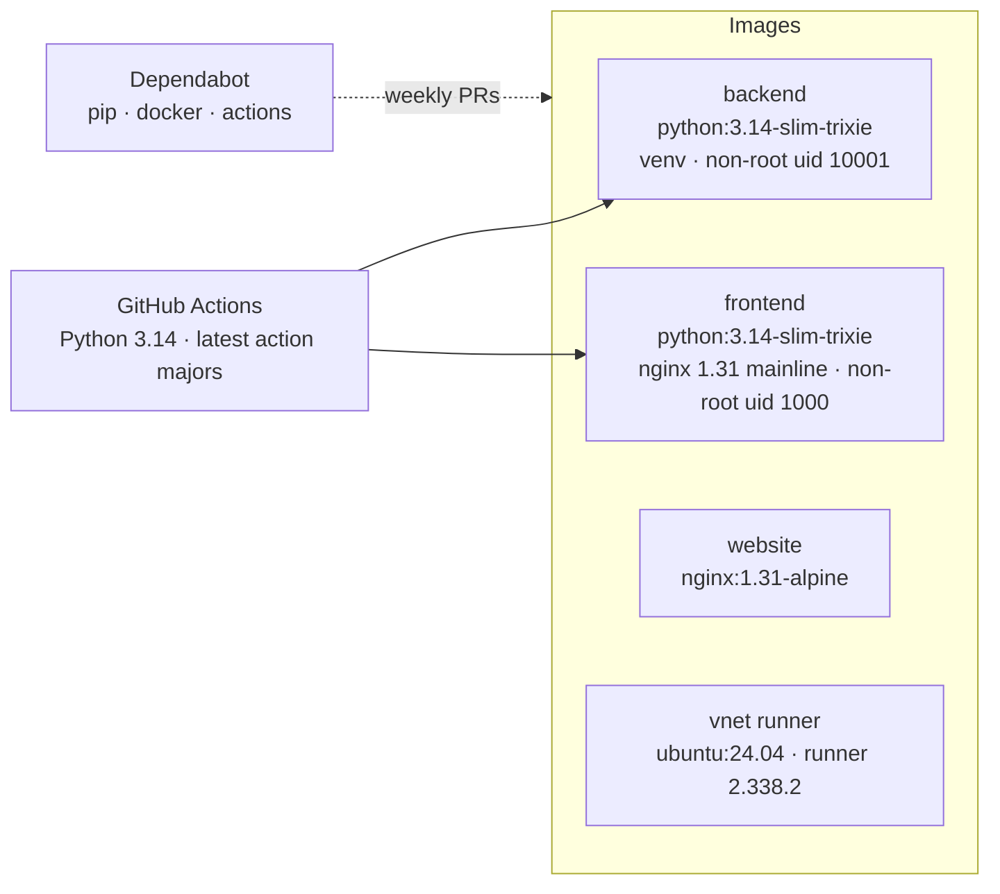

# Dependency & security refresh — November 2026

**Goal:** move every image, runtime package and workflow action to its current release, remove
unused dependencies, and harden the containers so the app and site stay maintainable and secure.

## What changed



| Area | Before | After |
|---|---|---|
| Python (images + CI) | 3.11 | 3.14 (3.15 skipped: too new, wheel gaps) |
| pip | image default | 26.3 |
| Backend base | `mcr.microsoft.com/devcontainers/python:3.11` (dev image with a passwordless-sudo `vscode` user) | `python:3.14-slim-trixie`, multi-stage, `/opt/venv`, `apt-get upgrade`, non-root `appuser` |
| Frontend base / nginx | `python:3.11-slim`, Debian nginx package | nginx.org mainline 1.31.x (key fingerprint-verified, apt-pinned), `server_tokens off` |
| Streamlit | 1.37.0 | 1.67.0 |
| Website | `nginx:alpine` (floating) | `nginx:1.31-alpine` |
| Runner | ubuntu 22.04, runner 2.336.0 | ubuntu 24.04, runner 2.338.2, venv on PATH (PEP 668) |
| Telemetry | opencensus (deprecated) | `microsoft-opentelemetry` 1.6.0 distro |
| Actions | checkout v4, setup-python v5, upload v4, download v4, azure/login v2, create-pull-request v6 | v7, v7, v7, v8, v3, v8 |

**Removed (unused):** backend `aiohttp`, `aiofiles`, `fastapi-azure-auth`,
`azure-mgmt-policyinsights`, `azure-mgmt-cognitiveservices`, `opencensus*`; frontend `plotly`,
`streamlit-aggrid`, `requests`, `python-dotenv`, `numpy` (pandas brings it). Test-only packages
moved to `app/backend/requirements-dev.txt`, so pytest no longer ships in the production image.

## Why / decisions

- **Exact pins everywhere** + Dependabot: reproducible builds, upgrades arrive as reviewable PRs.
  Streamlit majors are ignored by Dependabot because Streamlit upgrades change rendered CSS.
- **Microsoft OpenTelemetry distro** (Warren's choice) replaces opencensus, which is retired.
  Sampling is via `OTEL_TRACES_SAMPLER=microsoft.fixed_percentage`; `/api/v1/health/ping` is
  excluded from tracing.
- **Streamlit 1.67** emits `.st-emotion-cache-* p/hN` rules that outrank single-class theme rules.
  `utils/theme.py` now scopes those rules under `[data-testid="stMarkdownContainer"]`. A side-by-side
  screenshot comparison of all 11 pages (1.37 vs 1.67) confirmed metric cards, headings and sidebar
  nav match. Accepted differences: buttons now honour the theme's 0.875rem, the header shows the
  theme's brand text, the sidebar defaults to 300px, and the file uploader has Streamlit's new design.
  `use_container_width=True` (deprecated) → `width="stretch"` (45 call sites).
- **Catalogue refresh RBAC** (BACKLOG B9): the weekly refresh had been failing since October on
  `LinkedAuthorizationFailed`. Fixed with a single-action custom role on the Container Apps
  environment. A stale catalogue would otherwise fail CI on every PR.

## Known residuals (not acted on)

- `python-jose` 3.5.0 → `ecdsa` 0.19.2 carries the Minerva timing advisory with no upstream fix.
  The app validates RS256 Entra tokens (not ECDSA), so it's not exploitable here; replacing
  `python-jose` with `PyJWT` is the long-term fix.
- `.xls` (legacy Excel) uploads need `xlrd`, which was never installed. Pre-existing gap.

## How to verify

```bash
# inside each running container app
python -V; pip --version; id; nginx -v   # frontend only
curl -sI https://<site>/ | grep -i server # → "nginx" with no version
```

Tests: `AZURE_OPENAI_ENDPOINT=https://x AZURE_OPENAI_DEPLOYMENT_NAME=x PYTHONPATH=app/backend
python -m pytest app/tests --noconftest -q` with `requirements-dev.txt` installed.
Add `--ignore=tests/e2e` unless a Streamlit server is running: the Playwright e2e tests error
without one, and the sync Playwright event loop then breaks ~125 later async tests in the same run
(each passes in isolation). CI runs named files only, so it is unaffected.
